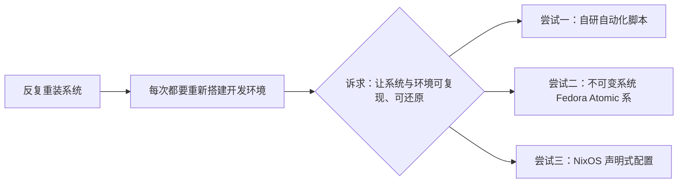

# 关于「可重现开发环境」的折腾与思考

> 备注：文档是根据我的口述表达和描述，利用AI生成的，后期经过我简单修改而成

> 每一次重装系统，都是一场对记忆力和耐心的双重考验。
> 真正难的从来不是装系统，而是把那个「顺手到仿佛从未离开过」的开发环境，原封不动地搬回来。

## 🤔 缘起

我有过一段频繁重装系统的时期。装系统本身半小时搞定，最要命的是**重建开发环境**：JDK、Node、Python、数据库、IDE 及插件、SSH 密钥、环境变量……零零散散搭上大半天。

痛点很明确：

- **重复劳动**：同样的事一遍遍做；
- **依赖记忆**：配置全靠回忆，「当初改过哪个环境变量」每次都要重新排查；
- **不可回溯**：一切状态只存在于脑子里和这台机器上。

于是「如何快速重现我的系统与开发环境」成了我的一个执念。



---

## 📜 尝试一：自研脚本

思路很直接：**既然每次都做同样的事，那就让脚本替我做。** 把安装清单、配置写入固化成 Shell，跑一遍脚本，环境回来大半。

> <a href="../../resource/files/system-rebuild-shell.sh" download>debian系、rh系重装脚本</a>  
> <a href="../../resource/files/system-rebuild-python.py" download>debian系、rh系重装脚本-python实现的版本</a>

**收获**：把「大脑里的经验」转成「可执行的代码」，常用软件安装确实被加速了。

**问题**：

- 清单越列越长，脚本越写越臃肿；
- 机器差异导致满屏 `if` 分支兜底；
- 难以保证幂等，跑两遍结果可能不一样；
- 维护成本很快超过收益，最终停留在「半成品」状态。

> 事后反思：这类问题早有成熟解法（dotfiles、Ansible、chezmoi 等），「从零手写轮子」最有成就感，也最容易半途而废。

---

## 📦 尝试二：Fedora Atomic 系

Fedora 不可变系统的理念一度非常打动我：**根分区只读**（ostree 镜像化）、**原子化更新**、失败可回滚，应用层交给 Flatpak 隔离。对于「三天两头把系统玩坏」的人来说简直是救赎。

但真正上手开发后问题暴露了：**它把「系统」管好了，却没把「开发环境」安排好。**

- `dnf install`、往 `/usr`、`/opt` 装工具链的路子走不通，只能依赖 toolbox / distrobox 容器；
- 容器内外工具链割裂，版本、路径、配置各自为政；
- IDE、远程调试、图形程序、USB 权限等场景都要多做一层透传；
- 数据、密钥、缓存散落在不同容器里，切环境像搬家。

我要的是**一个整体顺手、开箱即用的开发环境**，不是一堆互不相认的沙箱。

> 事后反思：工具是对的，只是没对准我的问题——它解决「系统可回滚」，没解决「开发环境整体可重现」。

---

## ❄️ 尝试三：NixOS

NixOS 几乎把「可重现」做到了理论极致：**整个系统 = 一份配置文件**（`/etc/nixos/configuration.nix`），环境即代码，可回滚，依赖锁定到 hash 级别。**配置本身就是备份。**

但我最终没有走下去：

- **国内网络不友好**：默认依赖海外源，得先折腾镜像源，「开箱即用」变成「先折腾半小时」；
- **生态在国内不流行**：资料、社区以英文海外为主，排查路径长；
- **学习成本陡峭**：Nix 语言、flake、nixpkgs 是一整套全新心智模型；
- **成熟度感受**：日常边角问题不少，更像「极客的乐高」而非「生产环境的底座」。

**不是说它不好，而是现阶段为它付出的成本超出了收益。**

---

## ⚖️ 对比与沉淀

三次尝试走下来，我真正想要的是：

1. **可复现**：一份配置在任意机器上能还原出基本一致的环境；
2. **低维护**：不要为了管理环境而花更多时间维护管理工具本身；
3. **低心智负担**：工具应该隐形，而不是成为主角。

| 方案 | 核心思路 | 优点 | 痛点 | 结论 |
|------|---------|------|------|------|
| 自研脚本 | 把重复操作写成代码 | 灵活、贴合习惯 | 覆盖面失控、幂等性差、维护成本高 | 半成品搁置，方向可借鉴 |
| Fedora Atomic 系 | 系统镜像化、原子更新 | 系统可回滚、更新安全 | 开发环境被容器隔离、互不互通 | 解决系统不解决环境，放弃 |
| NixOS | 全系统声明式 | 可复现性天花板 | 国内生态不友好、门槛高 | 理念认同，现阶段搁置 |

更深一层的沉淀：

- **把「状态」变成「声明」，而不是「步骤」**：描述「要什么」比描述「怎么做」更容易校验、重复执行和版本管理；
- **可回滚和幂等，是自动化的安全感来源**：它们让「试错」变得便宜；
- **分层解耦**：系统层交给发行版和快照，应用层交给包管理器，开发环境层用 dotfiles / 清单 / devcontainer 管理；
- **拥抱成熟生态，好过重复造轮子**：凡是感到「维护不动」的轮子，生态里多半早有更好的替代品。

---

## 🧭 改进方向

- **建立 dotfiles 仓库**：`.bashrc`、`.gitconfig`、编辑器配置集中管理，软链接一键部署；
- **写一份「环境依赖清单」**：装了什么、为什么装、怎么配——文档本身就是可重现的第一步；
- **把开发环境容器化**：用 Dockerfile / devcontainer 固化项目级依赖，代价远低于全系统方案；
- **善用系统快照/备份**：让「重装」从「冒险」变成「有兜底的操作」；
- **保持工具敏感度**：等 NixOS 国内生态成熟了，也许某天会重新纳入考虑。

---

## 🕳️ 重装踩坑记录

> 重装系统过程中实际遇到的问题，按发行版 / 场景分类整理，下次重装直接对照排查。

### 🐧 Debian

#### 1. KDE 日历没有农历

Debian 仓库中的 Plasma 版本较低，日历组件不带农历，需手动补装插件：

```bash
sudo apt install plasma-calendar-addons
```

#### 2. TLP 电源管理配置

借助 AI 生成了一套自动管理配置，重装后直接下载放入 `/etc/tlp.d/` 目录即可生效：

- <a href="../../resource/files/tlp/01-common.conf" download>tlp 通用配置</a>
- <a href="../../resource/files/tlp/10-ac.conf" download>tlp AC 电源优化配置</a>
- <a href="../../resource/files/tlp/20-bat.conf" download>tlp 电池优化配置</a>

#### 3. TLP 组件安装（含图形界面 `tlp-pd`）

基础组件直接安装即可：

```bash
sudo apt install tlp tlp-rdw
```

若想通过桌面小部件直接切换「性能 / 均衡 / 省电」模式（`tlp-pd` 的作用：让 TLP 与 KDE Plasma / GNOME 的电源管理小部件无缝集成，免去敲命令），需再补装 `tlp-pd`。该包有时因依赖版本问题无法正常安装，此时改用 Trixie Backports 源安装：

```bash
sudo apt -t trixie-backports install tlp tlp-pd tlp-rdw
```

#### 4. eza 图标显示为方块

eza 本体从 GitHub 下载后配置到本地即可正常使用，图标显示异常只是**缺少符号字体**，补装 Nerd Font 即可解决，界面其他字体无需改动：

```bash
# 字体：jetbrainsmono-nerd
```

#### 5. AppImage 应用无法运行

AppImage 依赖 FUSE，缺库时会直接报错：

```bash
sudo apt update && sudo apt install libfuse2   # Debian；较新版本系统包名为 libfuse2t64
sudo dnf install fuse-libs                     # Fedora 系
```

### 🐧 Arch Linux

#### 1. archinstall 最简化安装

用 `archinstall` 直接安装即可，注意几点：

- **语言选英文**：选中文会因字体缺失显示乱码，进入系统后再补装中文字体；
- **内核**：一般可选 `zen` 内核或 `lts` 长期支持版本；
- **软件包**：只装 `plasma-desktop`、`dolphin`、`konsole` 等核心工具，可按 `plasma` / `kde` 前缀搜索，不要贪多；
- **登录界面**：装完默认是命令行登录，需手动启用 SDDM（或 Plasma Login Manager），服务名可自行搜索确认，重启后即可正常进入图形登录界面。

#### 2. 补装缺失的桌面组件

最小化安装后部分常用组件缺失（如分辨率调整），按需补装：

```bash
sudo pacman -S \
  kscreen kinfocenter \        # 显示设置 + 系统信息
  plasma-pa \                  # 任务栏音量图标
  kde-gtk-config \             # 让 GTK 应用（Firefox 等）跟随 Plasma 主题
  xdg-desktop-portal-kde \     # 文件对话框、截图等桌面门户
  plasma-browser-integration \ # 浏览器与桌面整合（媒体控制、下载通知）
  ffmpegthumbs \               # 视频文件缩略图
  kdegraphics-thumbnailers     # 图片/PDF 缩略图
```

#### 3. 常用工具软件

```bash
sudo pacman -S \
  btop \        # 系统监控（htop/top 的现代替代品）
  ripgrep \     # rg，全文搜索，比 grep 快几十倍
  fd \          # 比 find 好用得多的文件查找
  eza \         # 现代化 ls，带颜色和图标
  tree \        # 目录树
  jq \          # 命令行处理 JSON
  unzip p7zip \ # 解压 zip/7z（arch 默认不带）
  wget rsync \  # 下载/同步
  openssh \     # ssh 客户端/服务端
  lsof strace \ # 查端口占用/程序卡死排障
  man-db man-pages \  # man 手册（minimal 安装里经常缺）
  plocate       # 秒级文件定位（装完执行一次 sudo updatedb）
```

#### 4. 声音与用户目录

```bash
sudo pacman -S pipewire-pulse   # 没有它系统可能没有声音！
sudo pacman -S xdg-user-dirs    # 生成 ~/文档 ~/下载 等标准目录
xdg-user-dirs-update            # 生成中文目录名
```

#### 5. KDE 常用应用

```bash
sudo pacman -S \
  gwenview spectacle \          # 看图 + 截图
  haruna \                      # 视频播放器
  kate \                        # 文本编辑器
  ark filelight partitionmanager \  # 压缩/磁盘占用/分区管理
  kdeconnect kcalc              # 手机互联 + 计算器
```

#### 6. 桌面门户与 Wayland 支持

```bash
sudo pacman -S xdg-desktop-portal-kde xorg-xwayland
sudo pacman -S qt6-wayland pipewire wireplumber
```

#### 7. 编程开发相关

```bash
sudo pacman -S \
  git base-devel \  # base-devel 装 yay 时应该已有，保险起见确认下
  neovim \          # 终端编辑器（比 vim 配置生态好）
  gcc gdb \         # C/C++ 编译调试
  python python-pip \
  cmake ninja \
  sqlite
```

#### 8. 系统字体

```bash
sudo pacman -S noto-fonts-cjk noto-fonts-emoji ttf-jetbrainsmono-nerd
```

#### 9. virt-manager 虚拟化全套

```bash
sudo pacman -S qemu-full libvirt virt-manager \
  dnsmasq iptables-nft \
  edk2-ovmf swtpm \
  spice-gtk spice-vdagent virtiofsd
```

### 💻 VSCode 中 Trae 插件登录认证中断

独立安装的 VSCode 走浏览器 OAuth 登录时，浏览器无法回调唤起原窗口，认证流程会中断，需手动补最后一步：

1. 正常走登录流程，在浏览器最后一步**复制回调 URI**（形如 `vscode://...`）；
2. 回到 VSCode 的认证提示处，打开终端，执行（`code` 需替换为 VSCode 的完整路径）：

```bash
code --open-url "vscode://..."
```

执行后即完成整个认证流程。

### ⌨️ Flatpak 应用无法使用系统输入法（fcitx）

在菜单管理器（如 Flatseal）中为应用设置以下环境变量即可：

```bash
GTK_IM_MODULE=fcitx
QT_IM_MODULE=fcitx
XMODIFIERS=@im=fcitx
```

**例外**：Debian 下 Flatpak 版 Firefox 需清空 `GTK_IM_MODULE`，只保留后两项，否则反而无法输入：

```bash
GTK_IM_MODULE=
QT_IM_MODULE=fcitx
XMODIFIERS=@im=fcitx
```

### 🐚 自定义 shell 脚本

为美化 bash 提示符、快速识别当前所处环境（进入 distrobox / Python 虚拟环境时会有明确提示），借助 AI 写了一个脚本，保存在这里方便复用、下载和优化：

<a href="../../resource/files/bash/.dynamic_prompt_setup" download>bash美化和环境高辨识脚本</a>  

---

## ✍️ 写在最后

> **重装系统本身不可怕，可怕的是重装之后一切要「无中生有」。**

真正解决「环境重建难」的不是某个发行版或某个工具，而是一种意识——**别把环境只存在机器里，要把它存在「可执行、可复现」的形式里。**

「配置即代码、环境可重现」这个思路，会一直留在我这里。路还长，继续折腾，继续沉淀。

---

*最后更新：{docsify-updated}*
